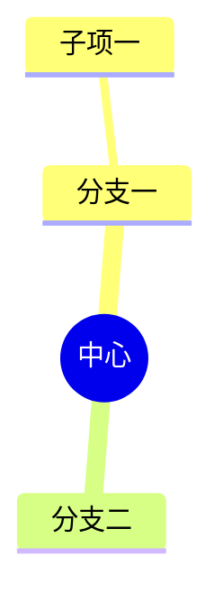

# 图的可视化编辑（思维导图 / 流程图）

> 目标：不会写 mermaid 语法的人也能改图；会写的人照样能改源码。两边改的是同一份数据。

## 一、数据形态没变

笔记里存的仍是**普通围栏代码块**：

````

````

好处是导出 Markdown、GitHub / 语雀渲染、用别的编辑器打开都还认。可视化编辑只是这块代码的
**另一种编辑方式**，不是新格式：

```
画布（MindmapEditor / FlowchartEditor）
   ↓ 每次改动
mindmap.ts / flowchart.ts 的 serialize
   ↓
draft（mermaid 文本）→ 面板「完成」→ 写回 code_block
```

反过来，在「代码」模式下改完源码再切回「可视化」，会用新源码重新解析。

## 二、两种图，一块面板

| 源码第一行 | 画什么 | 能表达什么 |
|---|---|---|
| `mindmap` | 自动布局的树（`MindmapEditor`） | 从属：谁在谁下面。**不能**任意两节点相连 |
| `flowchart` / `graph` | 自由摆放的图（`FlowchartEditor`） | 任意关系：谁连谁由人拉线决定 |

面板标题、提示语、画布都跟着源码自动换 —— 用户不需要知道自己那段属于哪一类。

| | 可视化（默认） | 代码 |
|---|---|---|
| 适合谁 | 不想碰语法的人 | 要写时序图 / 类图，或精确控制样式的人 |
| 画布 | 整块弹窗 | 左源码 + 右实时预览（原有布局） |

- 两种图都解析不了（时序图、类图、语法写坏）就停在代码模式。点「可视化」会就地说明原因
  （红色一行），**不会**把源码清空。
- `Esc` 关闭面板；在节点输入框里按 `Esc` 只取消这次改名，不关面板。

## 三、思维导图上能做什么

| 操作 | 做法 |
|---|---|
| 改字 | 双击节点（或选中后按 `F2`） |
| 加下级 | 选中节点按 `Tab`，或点「加子节点」 |
| 加同级 | 选中节点按 `回车`，或点「加同级」 |
| 删节点 | 选中按 `Delete` / `Backspace`（根节点不给删） |
| 换父级 | 把节点拖到另一个节点上松手；拖到自己子树里会被忽略 |

## 四、流程图上能做什么

| 操作 | 做法 |
|---|---|
| 加节点 | 「加节点」（落点总在现有节点的下方，不压别人） |
| 接一个下去 | 选中节点后「接下一个」：新节点落在右边并自动连一条线 |
| **任意两节点连线** | 按住节点右边缘那个小圆点，拖到另一个节点上松手 |
| 删连线 | 点一下线（变蓝），按 `Delete` 或点「删除」 |
| 写 / 改连线文字 | 双击那条线 |
| 挪位置 | 直接拖节点（松手才落盘，一路拖不产生几十个撤销点） |
| 换形状 | 选中节点，工具条上的下拉：方框 / 圆角 / 胶囊 / 菱形 / 圆形 / 六边形 |
| 删节点 | 选中按 `Delete`；连在它身上的线一起删 |

### 位置存在哪儿

mermaid 自己不排位置（渲染时才排），所以坐标写进注释：

```
flowchart TD
  A["开始"] --> B["结束"]
%% @pos A 40 40
%% @pos B 250 40
```

`%%` 是注释，渲染时被忽略，打开图时读回来 —— 「摆好的样子」也落盘了，换台电脑位置不变。
没有 `@pos` 的老文本按层级自动摆一次。

### 自动排版：先去掉回边，再按 DAG 分层

原来的写法是「能走多深就记多深」。遇上有回路的图（`K -- 否 --> D` 就是一条，试测流程图里
很常见），会一路算到第 60 层才停，于是 12 个节点被推到 x≈12600，画布一万多像素宽，
屏幕上只剩一条横穿整个画布的连线。

现在的做法（`flowchart.ts` 的 `layering`）：

1. DFS 找出**回边**（指向当前路径上祖先的那条），只标记、不参与分层；
2. 剩下的图按 DAG 算最长路径 → 层数最多等于节点数；
3. 相邻两层各扫两轮重心排序，把节点往它的前驱旁边挪，减少交叉；
4. 方向跟着 `flowchart TD/LR` 走：TD 竖排、LR 横排，每层沿横向居中。

回路本身**还在**，只是不参与排版 —— 打开还是能看见「否」那条线。

> 已经被 0.4.9 写死了坏坐标的笔记：读回 `@pos` 后先做一次合理性检查
> （外接尺寸 > `max(4000, 节点数 × 700)` 就不信），不可信就整段丢掉重新排。
> 判据写在 `placementsSane` 里。

### 打开时的视角

- 整张图缩到 70% 以上还能放进画布 → 直接「适应窗口」，先给全貌；
- 放不进去 → **不缩**（缩到 40% 字就糊了），改为横向居中、从第一步开始看，滚轮往下平移。

## 四·五、配色：分支定色相，深度定明度

mermaid 自带的 neutral / dark 主题对 mindmap 只会**深浅交替**涂（浅灰、深灰、浅灰），
根节点还和一级分支同色 —— 结果就是「看不出中心」，浅灰底上的字也发虚。

现在由 `palette.ts` 统一算（渲染出来的图和可视化编辑器共用同一份）：

| 深度 | 浅色主题 | 暗色主题 |
|---|---|---|
| 中心 | 深藏青底 + 白字加粗 | 亮蓝底 + 深字加粗 |
| 一级分支 | 该分支色相 43% 明度 + 白字 | 34% 明度 + 浅字 |
| 二级 | 该色相 90% 亮底 + 深字 | 24% 明度 + 浅字 |
| 三级以后 | 96% 亮底 + 深字 | 18% 明度 + 浅字 |

六个色相：蓝（与主色同族）、青、紫、琥珀、玫红、绿。连线跟着通向的那个分支取色。

深度从哪来：mermaid 只给一级分支挂 `section-N`，深层节点没有钩子；但 DOM 里的节点顺序
就是树的先序遍历，所以拿自己解析出来的树按序对一遍即可（`mermaid.ts` 的 `tintMindmap`）。
上色写在**行内样式**上 —— mermaid 生成的 `<style>` 是 `#id .section-0 rect` 这种带 id 的选择器，
外挂 CSS 压不过它。


## 五、两个方向都能转

| 从 | 到 | 入口 |
|---|---|---|
| 嵌套列表 / 标题大纲 | 导图 | 光标在大纲里 → 顶栏第二行「转成导图」 |
| 导图 | 嵌套列表 | 面板底部「转成列表」（只在 `mindmap` 时出现） |

转出来的仍是 ```mermaid 代码块，跟手点「思维导图」插入的东西没有区别。
转换时如果内容有多个并列根，会补一个「中心主题」当壳；转回列表时这个壳会被去掉。

`flowchart` 不能转列表：图的边不是层级，转出来是编造的父子关系。

## 六、会丢什么

可视化模式保存时会**丢掉样式指令**：`::icon(...)`、`:::class`。图上看不见它们，留着等于骗人。
节点形状（`[] () (()) ))(( )( {{}}` / `[] () {} ([]) (()) {{}}`）和文字会原样带回去 ——
解析时记住、序列化时还原。

流程图的 `subgraph` / `class` / `style` / `click` 之类声明**一行都认不出来就整段不解析**，
面板退回代码模式。宁可不能可视化，也不要在保存时把用户写的声明悄悄删掉。

## 七、怎么删掉一张图

鼠标移到图上，左边会出现 **⋮⋮**（块手柄）→ 点它 → 「删除本块」。和删段落、删表格是同一套。

> 这一版之前手柄在图上不出现：导图块是「不可编辑的 NodeView」，`posAtCoords` 解出来的是块
> 边界（depth 0），手柄判定「不在块里」就收起了。现在坐标解不出来时退回按 DOM 数块
> （`blockFromDom`），导图 / 公式这类块也有手柄了。

## 八、布局为什么不用图库

节点 + 连线 + 拖拽，这一层一百多行就够。自己画的三个好处：节点样式跟着应用主题走、
序列化只有一份、不为一个弹窗多背一个库的体积。缩放与平移自己算（`transform-origin: 0 0`
配平移缩放，`Ctrl`+滚轮以光标为中心）。

## 九、验收

| 探针 | 覆盖 |
|---|---|
| `scripts/regression/suites/graph-lists-e2e.cjs`（20 项，入库） | 有回路的流程图排版不爆、坏 `@pos` 重排、导图配色分层；多段一次转列表、相邻列表合并、`Tab` 不漏焦点 |
| `.workbuddy/tmp/verify-mindmap.cjs`（21 项） | 默认可视化、改字、`Tab` 加节点、拖拽换父级、完成后源码同步、流程图走另一块画布 |
| `.workbuddy/tmp/verify-graph.cjs`（35 项） | 图上块手柄与「删除本块」、列表→导图、导图→列表、流程图加点 / 连线 / 拖动 / 改字 / 坐标落盘后再打开 |
| `.workbuddy/tmp/verify-graph2.cjs`（11 项） | 本轮：回路排版、坏坐标修复、分支配色（含暗色主题截图） |
