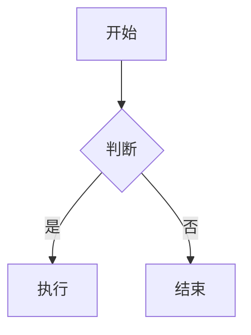

# 基础语法总览

这一段用来验证基本行内格式：**加粗**、*斜体*、`行内代码`、~~删除线~~，以及链接 [示例站点](https://example.com) 和图片 。  

## 二级标题

### 三级标题 

普通段落，用来在标题之间制造间隔。行内公式 $E = mc^2$ 放在这一段里。  

块级公式单独成段：  

$$
\int_0^1 x^2 \, dx = \frac{1}{3}
$$

## 列表

无序列表：  

- 第一项
- 第二项
- 第三项

有序列表：  

1. 第一步
2. 第二步
3. 第三步

任务列表：  

- [x] 已完成的事项
- [ ] 未完成的事项
- [ ] 另一件待办

## 引用与代码

> 这是一段引用。
> 引用可以跨行。

```ts
export function add(a: number, b: number): number {
  // 代码块内部
  return a + b;
}
```

## 表格

| 列一 | 列二 | 列三 |
|---|---|---|
| 甲 | 乙 | 丙 | 
| 1 | 2 | 3 |

## 分割线与脚注

---

这一行之后有一个脚注引用[^note]。  

[^note]: 脚注的内容写在这里。

## 流程图


