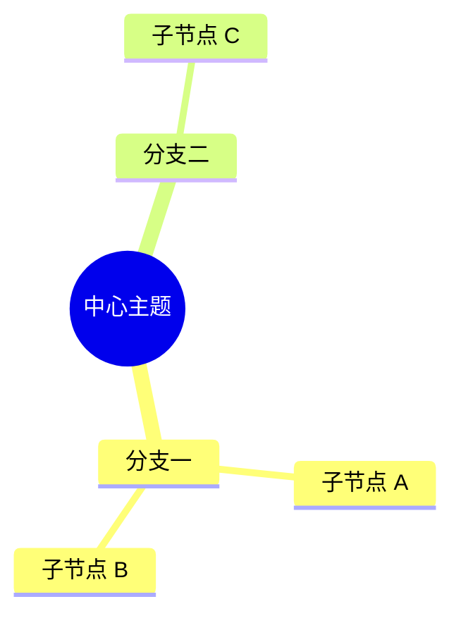

# 极端情况

## 多级引用

> 第一层引用
> > 第二层引用
> > > 第三层引用
> > > > 第四层引用

## 多级列表

- 第一层
  - 第二层
    - 第三层
      - 第四层
        - 第五层

1. 有序第一层
   1. 有序第二层
      1. 有序第三层

## 表格里的特殊字符

| 名称 | 表达式 | 说明 |
|---|---|---|
| 绝对值 | `\|x\|` | 竖线用反斜杠转义 |
| 公式 | $a \| b$ | 表格内的行内公式 |
| 代码 | `a \| b` | 表格内的行内代码 |

## 代码块里再放围栏

````markdown
```ts
const fence = '```';
```
````

## 加粗整块与 HTML 注释

**这一段整段加粗，用来观察编辑器是否会把块级强调拆成多个行内标记。**

<!-- 这一段是 HTML 注释，不应该被渲染出来 -->

正文里插入 <mark>高亮</mark>、<br> 断行标签，以及 <sub>下标</sub> 与 <u>下划线</u>。

## Mermaid 思维导图



## 脚注与连续空行

这里引用一个脚注[^a]，再引用另一个[^b]。


上面这两个空行是连续空行。

[^a]: 第一个脚注。
[^b]: 第二个脚注。

## 行尾空白与制表符

这一行结尾有两个空格，构成硬换行。  
这一行跟着上一行，属于同一个段落。

这一行结尾有一个制表符。	

这一行结尾有两个空格加一个制表符。  	

## 兜底

最后一行，用来确认文件末尾有换行。
